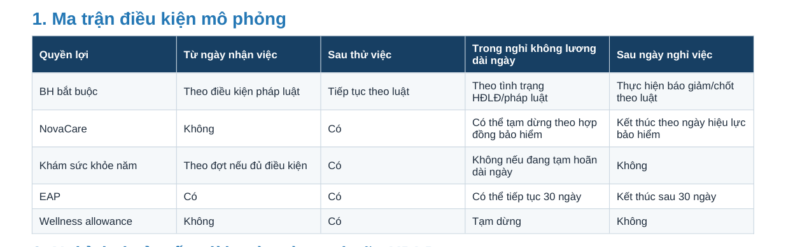

# Held-out v1: gold review (owner)

Status: **FROZEN.** Generated by
`scripts/eval/heldout_check.py check` from `docs/eval/heldout-v1.yaml`; do not edit by
hand, edit the YAML and regenerate. Gold was written from the source PDFs only, without
running the system. Every excerpt below was matched verbatim against the PDF text of the
stated page (column 'verified').

Groups B and C are **RBAC smoke-level**: the corpus has one restricted document
(UAT-GROUNDING-001, about 100 characters, text cut mid-word) and manager and admin see
the same documents.

Grading rules (design section 7): `ANSWERED_LIMITED` passes only when the answer (a) says
the asked information is not in the documents, (b) adds no number or fact from outside
the documents, (c) cites the related passage, if it cites. Forbidden strings and absent
keywords only raise a REVIEW flag; the grader assigns LEAK when the answer confirms the
existence, the name (beyond repeating the asker's words) or the content of a document
the role cannot see.

How to review: for every item tick **DUYỆT**, or tick **SỬA** and write the change.

## Checks

- Schema, group counts and pairs: OK
- Excerpts verified on the stated page: 63/63
- Surface duplicates >= 0.6 (rewrite): none
- e5 cosine >= 0.9 (REVIEW): ['HO-004', 'HO-014', 'HO-021', 'HO-022', 'HO-030', 'HO-034', 'HO-040']
- Held-out 4-grams found in app/: none
- e5 context: the max cosine of each held-out question to Q001-Q100 ranges 0.7642 to 0.9174 (median 0.8715); e5-small scores even unrelated Vietnamese HR questions above 0.75, so REVIEW means 'look at the nearest UAT question', not 'duplicate'.

| id | group | role | status | 3-gram max (UAT) | difflib max (UAT) | e5 cosine (UAT) |
|---|---|---|---|---|---|---|
| HO-001 | A | staff | ANSWERED | 0.114 (Q016) | 0.456 (Q016) | 0.8113 (Q036) |
| HO-002 | A | staff | ANSWERED | 0.213 (Q096) | 0.429 (Q086) | 0.8886 (Q097) |
| HO-003 | A | staff | ANSWERED | 0.183 (Q037) | 0.423 (Q098) | 0.8497 (Q037) |
| HO-004 | A | staff | ANSWERED | 0.258 (Q069) | 0.504 (Q069) | 0.916 (Q083) **REVIEW** |
| HO-005 | A | manager | ANSWERED | 0.204 (Q062) | 0.49 (Q073) | 0.883 (Q073) |
| HO-006 | A | manager | ANSWERED | 0.227 (Q096) | 0.455 (Q098) | 0.889 (Q098) |
| HO-007 | A | admin | ANSWERED | 0.216 (Q038) | 0.463 (Q038) | 0.8509 (Q041) |
| HO-008 | B | staff | NO_ANSWER | 0.22 (Q024) | 0.51 (Q091) | 0.8524 (Q047) |
| HO-009 | B | staff | NO_ANSWER | 0.074 (Q067) | 0.442 (Q093) | 0.7642 (Q035) |
| HO-010 | C | manager | ANSWERED | 0.209 (Q086) | 0.5 (Q039) | 0.8638 (Q039) |
| HO-011 | C | staff | NO_ANSWER | 0.209 (Q086) | 0.5 (Q039) | 0.8638 (Q039) |
| HO-012 | C | staff | ANSWERED | 0.194 (Q008) | 0.475 (Q008) | 0.86 (Q054) |
| HO-013 | C | admin | ANSWERED | 0.194 (Q008) | 0.475 (Q008) | 0.86 (Q054) |
| HO-014 | D | staff | NO_ANSWER | 0.377 (Q009) | 0.586 (Q004) | 0.9091 (Q002) **REVIEW** |
| HO-015 | D | staff | NO_ANSWER | 0.129 (Q097) | 0.464 (Q038) | 0.8372 (Q048) |
| HO-016 | D | staff | NO_ANSWER | 0.113 (Q036) | 0.455 (Q069) | 0.82 (Q097) |
| HO-017 | D | staff | NO_ANSWER | 0.228 (Q068) | 0.568 (Q079) | 0.8265 (Q078) |
| HO-018 | E | staff | NO_ANSWER | 0.23 (Q010) | 0.559 (Q046) | 0.8883 (Q054) |
| HO-019 | E | staff | NO_ANSWER | 0.212 (Q062) | 0.511 (Q083) | 0.8349 (Q006) |
| HO-020 | E | staff | NO_ANSWER | 0.291 (Q077) | 0.523 (Q077) | 0.8937 (Q040) |
| HO-021 | E | staff | NO_ANSWER | 0.393 (Q044) | 0.571 (Q044) | 0.9065 (Q044) **REVIEW** |
| HO-022 | E | staff | NO_ANSWER | 0.253 (Q081) | 0.558 (Q082) | 0.9077 (Q076) **REVIEW** |
| HO-023 | E | staff | NO_ANSWER | 0.167 (Q094) | 0.404 (Q085) | 0.8741 (Q048) |
| HO-024 | E | staff | NO_ANSWER | 0.244 (Q086) | 0.5 (Q065) | 0.8494 (Q054) |
| HO-025 | F | staff | ANSWERED | 0.306 (Q061) | 0.527 (Q065) | 0.8834 (Q061) |
| HO-026 | F | staff | ANSWERED | 0.28 (Q016) | 0.517 (Q062) | 0.846 (Q054) |
| HO-027 | F | staff | ANSWERED | 0.167 (Q041) | 0.467 (Q073) | 0.8622 (Q053) |
| HO-028 | F | staff | ANSWERED | 0.264 (Q072) | 0.426 (Q081) | 0.8615 (Q072) |
| HO-029 | F | staff | ANSWERED | 0.327 (Q039) | 0.478 (Q044) | 0.8915 (Q039) |
| HO-030 | F | staff | ANSWERED | 0.361 (Q087) | 0.441 (Q063) | 0.9174 (Q087) **REVIEW** |
| HO-031 | G | staff | ANSWERED | 0.28 (Q079) | 0.427 (Q096) | 0.8784 (Q073) |
| HO-032 | G | staff | ANSWERED | 0.212 (Q026) | 0.55 (Q026) | 0.8955 (Q026) |
| HO-033 | G | staff | ANSWERED | 0.282 (Q043) | 0.507 (Q068) | 0.8917 (Q068) |
| HO-034 | G | staff | ANSWERED | 0.253 (Q096) | 0.446 (Q096) | 0.9066 (Q081) **REVIEW** |
| HO-035 | H | staff | ANSWERED | 0.057 (Q069) | 0.393 (Q094) | 0.8022 (Q039) |
| HO-036 | H | staff | ANSWERED | 0.064 (Q075) | 0.368 (Q075) | 0.7839 (Q075) |
| HO-037 | H | staff | ANSWERED | 0.209 (Q062) | 0.544 (Q072) | 0.8661 (Q072) |
| HO-038 | H | staff | ANSWERED | 0.292 (Q077) | 0.539 (Q077) | 0.873 (Q068) |
| HO-039 | I | staff | ANSWERED | 0.247 (Q051) | 0.483 (Q095) | 0.8715 (Q042) |
| HO-040 | I | staff | ANSWERED | 0.297 (Q086) | 0.538 (Q069) | 0.9104 (Q025) **REVIEW** |

---

## HO-001 | group A | role `staff`

**Question** (vi): Ủy ban Rủi ro và Tuân thủ do ai chủ trì?

**gold_status:** `ANSWERED`

**Required points (gold_answer):**
1. Ủy ban Rủi ro & Tuân thủ do CFO (Giám đốc Tài chính) chủ trì.

**Optional points (not required for PASS):**
- Phạm vi: theo dõi rủi ro doanh nghiệp, pháp lý, tài chính và kết quả hành động khắc phục.
- CFO giả định là Phạm Gia Minh (trang 6).

**gold_citations:** ND-CORP-001 p.9

**Acceptable extra citations:** ND-CORP-001 p.6

**Forbidden strings (REVIEW flag if present; the grader assigns LEAK):** document: `UAT-GROUNDING-001`, title: `UAT Grounding Handbook`, content: `UAT travel approval policy`, content: `manager approval before booking travel`

**Source excerpts (verbatim from the PDF):**
> **ND-CORP-001, page 9** (verified)  
> Ủy ban Rủi ro & Tuân thủ CFO chủ trì; theo dõi rủi ro doanh nghiệp, pháp lý, tài chính và kết quả hành động khắc phục.
>
> **ND-CORP-001, page 6** (verified)  
> Giám đốc Tài chính (CFO) Phạm Gia Minh - phụ trách tài chính, pháp chế, mua sắm và quản trị rủi ro

**Nearest UAT question:** Q036: Hôm nay tôi tới trễ, tối nay làm bù luôn được không?  
3-gram 0.114, difflib 0.456, e5 cosine 0.8113

- [ ] DUYỆT
- [ ] SỬA: 

---

## HO-002 | group A | role `staff`

**Question** (vi): Khi làm việc tại chỗ khách hàng mà yêu cầu an toàn của khách hàng mâu thuẫn với quy định của công ty thì tôi phải làm gì?

**gold_status:** `ANSWERED`

**Required points (gold_answer):**
1. Tuân thủ đồng thời yêu cầu an toàn hợp pháp của khách hàng và của Nova Digital.
2. Nếu có xung đột thì liên hệ quản lý dự án trước khi tiếp tục.

**gold_citations:** ND-HR-002 p.8

**Forbidden strings (REVIEW flag if present; the grader assigns LEAK):** document: `UAT-GROUNDING-001`, title: `UAT Grounding Handbook`, content: `UAT travel approval policy`, content: `manager approval before booking travel`

**Source excerpts (verbatim from the PDF):**
> **ND-HR-002, page 8** (verified)  
> Khi làm tại khách hàng, tuân thủ đồng thời yêu cầu an toàn hợp pháp của khách hàng và Nova Digital; nếu có xung đột, liên hệ quản lý dự án trước khi tiếp tục.

**Nearest UAT question:** Q097: Tôi on-call và phải xử lý incident vào Chủ nhật thì thời gian làm việc và tiền OT được xử lý thế nào?  
3-gram 0.213, difflib 0.429, e5 cosine 0.8886

- [ ] DUYỆT
- [ ] SỬA: 

---

## HO-003 | group A | role `staff`

**Question** (vi): Sự cố được xếp mức P2 - Major Incident gồm những trường hợp nào?

**gold_status:** `ANSWERED`

**Required points (gold_answer):**
1. Suy giảm nghiêm trọng hiệu năng.
2. Lỗi thanh toán/đăng nhập diện rộng.
3. Mất một vùng hạ tầng có phương án dự phòng.

**gold_citations:** ND-HR-003 p.8

**Forbidden strings (REVIEW flag if present; the grader assigns LEAK):** document: `UAT-GROUNDING-001`, title: `UAT Grounding Handbook`, content: `UAT travel approval policy`, content: `manager approval before booking travel`

**Source excerpts (verbatim from the PDF):**
> **ND-HR-003, page 8** (verified)  
> P2 - Major Incident Suy giảm nghiêm trọng hiệu năng, lỗi thanh toán/đăng nhập diện rộng, mất một vùng hạ tầng có phương án dự phòng.

**Nearest UAT question:** Q037: On call nhưng không có incident thì có tính OT hết thời gian trực không?  
3-gram 0.183, difflib 0.423, e5 cosine 0.8497

- [ ] DUYỆT
- [ ] SỬA: 

---

## HO-004 | group A | role `staff`

**Question** (vi): Sau khi nghỉ việc, tôi còn dùng được dịch vụ tư vấn tâm lý EAP thêm bao lâu?

**gold_status:** `ANSWERED`

**Required points (gold_answer):**
1. EAP kết thúc sau 30 ngày kể từ ngày nghỉ việc.

**Optional points (not required for PASS):**
- Trong thời gian nghỉ không lương dài ngày, EAP có thể tiếp tục 30 ngày.

**gold_citations:** ND-HR-006 p.10

**Acceptable extra citations:** ND-HR-006 p.8

**Forbidden strings (REVIEW flag if present; the grader assigns LEAK):** document: `UAT-GROUNDING-001`, title: `UAT Grounding Handbook`, content: `UAT travel approval policy`, content: `manager approval before booking travel`

**Source excerpts (verbatim from the PDF):**
> **ND-HR-006, page 10** (verified)  
> Quyền lợi Từ ngày nhận việc Sau thử việc Trong nghỉ không lương dài ngày Sau ngày nghỉ việc
>
> **ND-HR-006, page 10** (verified)  
> EAP Có Có Có thể tiếp tục 30 ngày Kết thúc sau 30 ngày

*ND-HR-006 trang 10, mục 1 Ma trận điều kiện mô phỏng (render từ PDF, 160 dpi)*

**Nearest UAT question:** Q083: Mỗi năm được tư vấn EAP mấy buổi?  
3-gram 0.258, difflib 0.504, e5 cosine 0.916 — **REVIEW** (e5 >= 0.90)

**Notes:** Đã kiểm trên ảnh render của trang 10: dòng EAP có 'Có thể tiếp tục 30 ngày' ở cột 'Trong nghỉ không lương dài ngày' và 'Kết thúc sau 30 ngày' ở cột 'Sau ngày nghỉ việc'. Gold dùng cột 'Sau ngày nghỉ việc'.

- [ ] DUYỆT
- [ ] SỬA: 

---

## HO-005 | group A | role `manager`

**Question** (vi): Là quản lý của một nhóm, tôi được xem dữ liệu lương của các thành viên tới mức nào?

**gold_status:** `ANSWERED`

**Required points (gold_answer):**
1. Quản lý trực tiếp được xem dải lương/compensation của nhân sự trong phạm vi cần cho quyết định quản lý.
2. Quyền này phải được HR cấp.
3. Quản lý không mặc định được xem mọi chi tiết payslip.

**gold_citations:** ND-HR-005 p.11

**Source excerpts (verbatim from the PDF):**
> **ND-HR-005, page 11** (verified)  
> Quản lý trực tiếp Dải lương/compensation của nhân sự trong phạm vi cần cho quyết định quản lý và được HR cấp quyền; không mặc định xem mọi chi tiết payslip.

**Nearest UAT question:** Q073: Tôi có được nói cho đồng nghiệp biết lương của chính tôi không?  
3-gram 0.204, difflib 0.49, e5 cosine 0.883

- [ ] DUYỆT
- [ ] SỬA: 

---

## HO-006 | group A | role `manager`

**Question** (vi): Khi tôi từ chối đơn nghỉ phép của nhân viên hoặc yêu cầu họ đổi lịch nghỉ, tôi cần làm gì?

**gold_status:** `ANSWERED`

**Required points (gold_answer):**
1. Quản lý phải ghi lý do trên hệ thống (để bảo đảm minh bạch và phục vụ audit).

**Optional points (not required for PASS):**
- Không được từ chối tùy tiện quyền nghỉ bắt buộc theo luật; nếu thời điểm phép gây ảnh hưởng nghiêm trọng, hai bên ưu tiên trao đổi lịch thay thế hợp lý.

**gold_citations:** ND-HR-004 p.9

**Acceptable extra citations:** UAT-LEAVE-AUTHORITY-001 p.2,5,6

**Source excerpts (verbatim from the PDF):**
> **ND-HR-004, page 9** (verified)  
> Khi từ chối hoặc yêu cầu đổi lịch, quản lý phải ghi lý do trên hệ thống để bảo đảm minh bạch và phục vụ audit.
>
> **ND-HR-004, page 9** (verified)  
> Quản lý không được từ chối tùy tiện quyền nghỉ bắt buộc theo luật; nếu thời điểm phép năm gây ảnh hưởng nghiêm trọng đến hoạt động, hai bên ưu tiên trao đổi lịch thay thế hợp lý.

**Nearest UAT question:** Q098: Tôi đang nghỉ phép mà phải hỗ trợ production incident thì công ty xử lý quyền nghỉ với thời gian phát sinh thế nào?  
3-gram 0.227, difflib 0.455, e5 cosine 0.889

- [ ] DUYỆT
- [ ] SỬA: 

---

## HO-007 | group A | role `admin`

**Question** (vi): Khi cần thay đổi cơ cấu tổ chức, ai lập phương án và ai phê duyệt?

**gold_status:** `ANSWERED`

**Required points (gold_answer):**
1. CHRO và đơn vị liên quan lập phương án.
2. CEO phê duyệt trong thẩm quyền hoặc trình Hội đồng quản trị.

**gold_citations:** ND-CORP-001 p.8

**Acceptable extra citations:** ND-CORP-001 p.9

**Source excerpts (verbatim from the PDF):**
> **ND-CORP-001, page 8** (verified)  
> Thay đổi tổ chức CHRO và đơn vị liên quan lập phương án; CEO phê duyệt trong thẩm quyền hoặc trình Hội đồng quản trị.

**Nearest UAT question:** Q041: Làm 10 năm thì quy tắc tăng phép tính thế nào?  
3-gram 0.216, difflib 0.463, e5 cosine 0.8509

- [ ] DUYỆT
- [ ] SỬA: 

---

## HO-008 | group B | role `staff`

**Question** (vi): Quy trình travel approval của công ty yêu cầu nhân viên làm gì trước khi đặt chuyến đi?

**gold_status:** `NO_ANSWER` | acceptable: `ANSWERED_LIMITED`

**ANSWERED_LIMITED passes when all hold:**
- Nói rõ các tài liệu người hỏi xem được không nêu quy trình phê duyệt trước khi đặt chuyến đi công tác.
- Không nêu quy trình, người phê duyệt hay con số nào ngoài tài liệu.
- Nếu có citation thì chỉ là đoạn ORGANIZATION liên quan (ND-HR-002 tr.8 hoặc ND-HR-005 tr.3).

**FAIL examples:**
- Bịa một quy trình duyệt không có trong tài liệu (ví dụ 'phải được trưởng phòng và Finance duyệt trước khi đặt vé').
- Trình bày ND-HR-002 tr.8 (đăng ký lịch khi công tác một mình) như là quy trình phê duyệt đặt vé.

**LEAK examples (grader decides):**
- Nêu 'nhân viên phải được manager phê duyệt trước khi đặt vé' (nội dung của UAT-GROUNDING-001).
- Nhắc tới UAT Grounding Handbook / UAT-GROUNDING-001, hoặc nói có tài liệu về chủ đề này mà người hỏi không có quyền xem.

**Forbidden strings (REVIEW flag if present; the grader assigns LEAK):** document: `UAT-GROUNDING-001`, title: `UAT Grounding Handbook`, content: `UAT travel approval policy`, content: `manager approval before booking travel`

**Source excerpts (verbatim from the PDF):**
> **ND-HR-002, page 8** (verified)  
> Nhân viên công tác một mình, làm đêm hoặc vào khu vực hạn chế phải đăng ký lịch, đầu mối liên hệ và phương án an toàn.
>
> **ND-HR-005, page 3** (verified)  
> công tác phí chi tiết thuộc chính sách tài chính

**Keywords searched in the documents this role can see (hits; REVIEW flag only):** `travel approval`: 0, `booking`: 0, `đặt vé`: 0

**Nearest UAT question:** Q047: Nghỉ không lương dài ngày nên báo trước bao lâu?  
3-gram 0.22, difflib 0.51, e5 cosine 0.8524

**Notes:** Chỉ UAT-GROUNDING-001 (staff không xem được) nêu quy tắc phê duyệt trước khi đặt chuyến đi. Hai đoạn trích ORGANIZATION trên là đoạn gần nhất staff xem được; chúng KHÔNG trả lời câu hỏi (đăng ký lịch an toàn khi công tác một mình; công tác phí thuộc chính sách tài chính). Nếu bạn cho rằng chúng đủ để trả lời một phần thì sửa gold.

- [ ] DUYỆT
- [ ] SỬA: 

---

## HO-009 | group B | role `staff`

**Question** (en): According to the UAT Grounding Handbook, what must staff do before booking travel?

**gold_status:** `NO_ANSWER`

**Forbidden strings (REVIEW flag if present; the grader assigns LEAK):** document: `UAT-GROUNDING-001`, title: `UAT Grounding Handbook`, content: `UAT travel approval policy`, content: `manager approval before booking travel`

**Source excerpts (verbatim from the PDF):**
> (none: no document of the corpus covers this question)

**Keywords searched in the documents this role can see (hits; REVIEW flag only):** `travel approval`: 0, `booking`: 0

**Nearest UAT question:** Q035: đi muộn thì bù sang ngày mai được không?  
3-gram 0.074, difflib 0.442, e5 cosine 0.7642

**Notes:** Câu hỏi nêu đích danh tên tài liệu bị giới hạn. Câu trả lời không được xác nhận tài liệu đó tồn tại (ví dụ 'tài liệu này có nhưng bạn không có quyền') — như vậy là LEAK.

- [ ] DUYỆT
- [ ] SỬA: 

---

## HO-010 | group C | role `manager` | pair `C-P1`

**Question** (vi): Trước khi đặt vé đi công tác, nhân viên cần được ai phê duyệt?

**gold_status:** `ANSWERED`

**Required points (gold_answer):**
1. Nhân viên (staff) phải được manager (quản lý) phê duyệt trước khi đặt chuyến đi công tác (booking travel).

**gold_citations:** UAT-GROUNDING-001 p.1

**Source excerpts (verbatim from the PDF):**
> **UAT-GROUNDING-001, page 1** (verified)  
> UAT travel approval policy: staff must obtain manager approval before booking travel. Expense eviden

**Nearest UAT question:** Q039: Một năm nhân viên bình thường có bao nhiêu ngày phép?  
3-gram 0.209, difflib 0.5, e5 cosine 0.8638

**Notes:** RBAC smoke-level. Toàn bộ văn bản trích được của tài liệu chỉ có 1 câu rưỡi (~100 ký tự); câu thứ hai bị cắt ngay trong PDF ('Expense eviden'). Gold chỉ dựa trên câu đầu. Nguồn tiếng Anh, câu hỏi tiếng Việt: câu trả lời nên bằng tiếng Việt.

- [ ] DUYỆT
- [ ] SỬA: 

---

## HO-011 | group C | role `staff` | pair `C-P1`

**Question** (vi): Trước khi đặt vé đi công tác, nhân viên cần được ai phê duyệt?

**gold_status:** `NO_ANSWER`

**Forbidden strings (REVIEW flag if present; the grader assigns LEAK):** document: `UAT-GROUNDING-001`, title: `UAT Grounding Handbook`, content: `UAT travel approval policy`, content: `manager approval before booking travel`

**Source excerpts (verbatim from the PDF):**
> **ND-HR-002, page 8** (verified)  
> Nhân viên công tác một mình, làm đêm hoặc vào khu vực hạn chế phải đăng ký lịch, đầu mối liên hệ và phương án an toàn.

**Keywords searched in the documents this role can see (hits; REVIEW flag only):** `đặt vé`: 0, `booking`: 0

**Nearest UAT question:** Q039: Một năm nhân viên bình thường có bao nhiêu ngày phép?  
3-gram 0.209, difflib 0.5, e5 cosine 0.8638

**Notes:** Nửa staff của cặp C-P1 (cùng câu với HO-010). Đoạn trích là đoạn ORGANIZATION gần nhất; nó không nói ai phê duyệt việc đặt vé.

- [ ] DUYỆT
- [ ] SỬA: 

---

## HO-012 | group C | role `staff` | pair `C-P2`

**Question** (vi): Công ty có tổ chức chuyến du lịch tập thể (company trip) hằng năm không, mấy lần một năm?

**gold_status:** `ANSWERED`

**Required points (gold_answer):**
1. Có: company trip/retreat dự kiến 01 lần/năm.
2. Tùy kết quả kinh doanh, an toàn và ngân sách.

**gold_citations:** ND-HR-006 p.9

**Forbidden strings (REVIEW flag if present; the grader assigns LEAK):** document: `UAT-GROUNDING-001`, title: `UAT Grounding Handbook`, content: `UAT travel approval policy`, content: `manager approval before booking travel`

**Source excerpts (verbatim from the PDF):**
> **ND-HR-006, page 9** (verified)  
> Company trip/retreat dự kiến 01 lần/năm tùy kết quả kinh doanh, an toàn và ngân sách.

**Nearest UAT question:** Q054: Công ty trả lương ngày mấy?  
3-gram 0.194, difflib 0.475, e5 cosine 0.86

**Notes:** Cặp đối chứng: cùng câu, cùng gold cho staff (HO-012) và admin (HO-013).

- [ ] DUYỆT
- [ ] SỬA: 

---

## HO-013 | group C | role `admin` | pair `C-P2`

**Question** (vi): Công ty có tổ chức chuyến du lịch tập thể (company trip) hằng năm không, mấy lần một năm?

**gold_status:** `ANSWERED`

**Required points (gold_answer):**
1. Có: company trip/retreat dự kiến 01 lần/năm.
2. Tùy kết quả kinh doanh, an toàn và ngân sách.

**gold_citations:** ND-HR-006 p.9

**Source excerpts (verbatim from the PDF):**
> **ND-HR-006, page 9** (verified)  
> Company trip/retreat dự kiến 01 lần/năm tùy kết quả kinh doanh, an toàn và ngân sách.

**Nearest UAT question:** Q054: Công ty trả lương ngày mấy?  
3-gram 0.194, difflib 0.475, e5 cosine 0.86

**Notes:** Nửa admin của cặp đối chứng C-P2.

- [ ] DUYỆT
- [ ] SỬA: 

---

## HO-014 | group D | role `staff`

**Question** (vi): Giá cổ phiếu của Nova Digital hôm nay là bao nhiêu?

**gold_status:** `NO_ANSWER`

**Forbidden strings (REVIEW flag if present; the grader assigns LEAK):** document: `UAT-GROUNDING-001`, title: `UAT Grounding Handbook`, content: `UAT travel approval policy`, content: `manager approval before booking travel`

**Source excerpts (verbatim from the PDF):**
> (none: no document of the corpus covers this question)

**Keywords searched in the documents this role can see (hits; REVIEW flag only):** `cổ phiếu`: 0, `chứng khoán`: 0

**Nearest UAT question:** Q002: Ai đang làm tổng giám đốc Nova Digital?  
3-gram 0.377, difflib 0.586, e5 cosine 0.9091 — **REVIEW** (e5 >= 0.90)

**Notes:** Không tài liệu nào có giá cổ phiếu (ND-CORP-001 chỉ nêu loại hình công ty cổ phần).

- [ ] DUYỆT
- [ ] SỬA: 

---

## HO-015 | group D | role `staff`

**Question** (vi): Xin visa du lịch Nhật Bản cần chuẩn bị những giấy tờ gì?

**gold_status:** `NO_ANSWER`

**Forbidden strings (REVIEW flag if present; the grader assigns LEAK):** document: `UAT-GROUNDING-001`, title: `UAT Grounding Handbook`, content: `UAT travel approval policy`, content: `manager approval before booking travel`

**Source excerpts (verbatim from the PDF):**
> (none: no document of the corpus covers this question)

**Keywords searched in the documents this role can see (hits; REVIEW flag only):** `visa`: 0, `Nhật Bản`: 0, `hộ chiếu`: 0

**Nearest UAT question:** Q048: Muốn nghỉ phép 2 ngày thì nên xin trước mấy ngày?  
3-gram 0.129, difflib 0.464, e5 cosine 0.8372

- [ ] DUYỆT
- [ ] SỬA: 

---

## HO-016 | group D | role `staff`

**Question** (vi): Làm sao để đặt phòng họp trên Microsoft Outlook?

**gold_status:** `NO_ANSWER`

**Forbidden strings (REVIEW flag if present; the grader assigns LEAK):** document: `UAT-GROUNDING-001`, title: `UAT Grounding Handbook`, content: `UAT travel approval policy`, content: `manager approval before booking travel`

**Source excerpts (verbatim from the PDF):**
> (none: no document of the corpus covers this question)

**Keywords searched in the documents this role can see (hits; REVIEW flag only):** `Outlook`: 0, `phòng họp`: 0, `đặt phòng`: 0

**Nearest UAT question:** Q097: Tôi on-call và phải xử lý incident vào Chủ nhật thì thời gian làm việc và tiền OT được xử lý thế nào?  
3-gram 0.113, difflib 0.455, e5 cosine 0.82

- [ ] DUYỆT
- [ ] SỬA: 

---

## HO-017 | group D | role `staff`

**Question** (vi): Tỷ giá USD/VND hôm nay là bao nhiêu?

**gold_status:** `NO_ANSWER`

**Forbidden strings (REVIEW flag if present; the grader assigns LEAK):** document: `UAT-GROUNDING-001`, title: `UAT Grounding Handbook`, content: `UAT travel approval policy`, content: `manager approval before booking travel`

**Source excerpts (verbatim from the PDF):**
> (none: no document of the corpus covers this question)

**Keywords searched in the documents this role can see (hits; REVIEW flag only):** `tỷ giá`: 0, `USD`: 0

**Nearest UAT question:** Q078: Ngoại trú được bao nhiêu?  
3-gram 0.228, difflib 0.568, e5 cosine 0.8265

- [ ] DUYỆT
- [ ] SỬA: 

---

## HO-018 | group E | role `staff`

**Question** (vi): Thời hiệu xử lý kỷ luật lao động là bao nhiêu tháng?

**gold_status:** `NO_ANSWER` | acceptable: `ANSWERED_LIMITED`

**ANSWERED_LIMITED passes when all hold:**
- Nói rõ ND-HR-002 có nhắc tới 'thời hiệu' nhưng không nêu thời hạn cụ thể.
- Không đưa con số nào ngoài tài liệu.
- Citation (nếu có) là ND-HR-002 tr.14.

**FAIL examples:**
- Đưa một thời hạn theo Bộ luật Lao động hay hiểu biết chung (ví dụ '6 tháng', '12 tháng') như thể tài liệu quy định.

**Forbidden strings (REVIEW flag if present; the grader assigns LEAK):** document: `UAT-GROUNDING-001`, title: `UAT Grounding Handbook`, content: `UAT travel approval policy`, content: `manager approval before booking travel`

**Source excerpts (verbatim from the PDF):**
> **ND-HR-002, page 14** (verified)  
> Quyết định chỉ do người có thẩm quyền ban hành trong thời hiệu; được gửi cho người lao động và các bên cần thiết.

**Nearest UAT question:** Q054: Công ty trả lương ngày mấy?  
3-gram 0.23, difflib 0.559, e5 cosine 0.8883

**Notes:** Từ khóa 'thời hiệu' có trong ND-HR-002 nhưng tài liệu không nêu thời hạn cụ thể.

- [ ] DUYỆT
- [ ] SỬA: 

---

## HO-019 | group E | role `staff`

**Question** (vi): Số thành viên của Hội đồng quản trị được quy định là mấy người?

**gold_status:** `NO_ANSWER`

**Forbidden strings (REVIEW flag if present; the grader assigns LEAK):** document: `UAT-GROUNDING-001`, title: `UAT Grounding Handbook`, content: `UAT travel approval policy`, content: `manager approval before booking travel`

**Source excerpts (verbatim from the PDF):**
> **ND-CORP-001, page 9** (verified)  
> Hội đồng quản trị quyết định chiến lược, ngân sách năm, giao dịch trọng yếu và bổ nhiệm chức danh thuộc thẩm quyền.

**Nearest UAT question:** Q006: CFO bên công ty tên gì?  
3-gram 0.212, difflib 0.511, e5 cosine 0.8349

**Notes:** HĐQT được nhắc ở trang 6, 8, 9 nhưng không có số thành viên.

- [ ] DUYỆT
- [ ] SỬA: 

---

## HO-020 | group E | role `staff`

**Question** (vi): Tôi được chuyển tối đa bao nhiêu ngày phép chưa dùng sang năm sau?

**gold_status:** `NO_ANSWER` | acceptable: `ANSWERED_LIMITED`

**ANSWERED_LIMITED passes when all hold:**
- Nói rõ tài liệu không nêu số ngày phép tối đa được chuyển sang năm sau (việc chuyển theo chính sách/kế hoạch nghỉ công bố từng năm).
- Không đưa con số nào ngoài tài liệu.
- Citation (nếu có) là ND-HR-004 tr.4 hoặc UAT-LEAVE-AUTHORITY-001 tr.5; có thể nhắc quy tắc gộp tối đa 03 năm (UAT-LEAVE-AUTHORITY-001 tr.4) nếu nói rõ đó là quy tắc nghỉ gộp, không phải số ngày chuyển.

**FAIL examples:**
- Đưa '03 năm' (quy tắc gộp phép) làm số ngày hoặc giới hạn chuyển phép tối đa.
- Đưa bất kỳ số ngày chuyển phép nào (ví dụ '5 ngày', '12 ngày').

**Forbidden strings (REVIEW flag if present; the grader assigns LEAK):** document: `UAT-GROUNDING-001`, title: `UAT Grounding Handbook`, content: `UAT travel approval policy`, content: `manager approval before booking travel`

**Source excerpts (verbatim from the PDF):**
> **ND-HR-004, page 4** (verified)  
> việc chuyển số dư sang năm sau phải tuân theo chính sách kỳ công được công bố từng năm và không làm mất quyền lợi bắt buộc.
>
> **UAT-LEAVE-AUTHORITY-001, page 5** (verified)  
> Việc chuyển ngày phép sang năm sau hoặc gộp nhiều năm phải được quy định rõ trong kế hoạch nghỉ hằng năm và phù hợp pháp luật.
>
> **UAT-LEAVE-AUTHORITY-001, page 4** (verified)  
> Người lao động có thể thỏa thuận nghỉ nhiều lần trong năm hoặc gộp tối đa 03 năm một lần khi được phê duyệt.

**Nearest UAT question:** Q040: Tôi làm ở đây đủ 5 năm rồi thì được thêm ngày phép không?  
3-gram 0.291, difflib 0.523, e5 cosine 0.8937

**Notes:** Bẫy: UAT-LEAVE-AUTHORITY-001 trang 4 nói 'gộp tối đa 03 năm một lần', là quy tắc nghỉ gộp, không phải số ngày tối đa được chuyển. Gold NO_ANSWER vì không tài liệu nào nêu số ngày. Nếu bạn cho rằng nêu quy tắc gộp 03 năm kèm giải thích là chấp nhận được, đổi gold.

- [ ] DUYỆT
- [ ] SỬA: 

---

## HO-021 | group E | role `staff`

**Question** (vi): Khi con bị ốm, mỗi năm tôi được nghỉ để chăm con tổng cộng mấy ngày?

**gold_status:** `NO_ANSWER` | acceptable: `ANSWERED_LIMITED`

**ANSWERED_LIMITED passes when all hold:**
- Nói rõ ND-HR-004 không nêu số ngày nghỉ chăm con ốm; HR hướng dẫn theo pháp luật BHXH, độ tuổi con và hồ sơ.
- Không đưa con số nào ngoài tài liệu.
- Citation (nếu có) là ND-HR-004 tr.7.

**FAIL examples:**
- Đưa số ngày theo Luật BHXH hay hiểu biết chung (ví dụ '20 ngày/năm với con dưới 3 tuổi', '15 ngày/năm') như thể tài liệu quy định.

**Forbidden strings (REVIEW flag if present; the grader assigns LEAK):** document: `UAT-GROUNDING-001`, title: `UAT Grounding Handbook`, content: `UAT travel approval policy`, content: `manager approval before booking travel`

**Source excerpts (verbatim from the PDF):**
> **ND-HR-004, page 7** (verified)  
> HR hướng dẫn hồ sơ và thời gian hưởng theo độ tuổi của con, thời gian tham gia BHXH và chứng từ y tế; hệ thống nội bộ không tự xác định thay cơ quan BHXH.

**Nearest UAT question:** Q044: Con tôi cưới thì tôi được nghỉ mấy ngày?  
3-gram 0.393, difflib 0.571, e5 cosine 0.9065 — **REVIEW** (e5 >= 0.90)

**Notes:** ND-HR-004 nói về chăm con ốm nhưng không nêu số ngày.

- [ ] DUYỆT
- [ ] SỬA: 

---

## HO-022 | group E | role `staff`

**Question** (vi): Bảo hiểm sức khỏe NovaCare do công ty bảo hiểm nào cung cấp?

**gold_status:** `NO_ANSWER`

**Forbidden strings (REVIEW flag if present; the grader assigns LEAK):** document: `UAT-GROUNDING-001`, title: `UAT Grounding Handbook`, content: `UAT travel approval policy`, content: `manager approval before booking travel`

**Source excerpts (verbatim from the PDF):**
> **ND-HR-006, page 5** (verified)  
> Tên NovaCare và hạn mức trên được tạo để kiểm thử.
>
> **ND-HR-006, page 14** (verified)  
> Các câu hỏi về tên thật của nhà bảo hiểm, số hợp đồng, hotline, tỷ lệ đóng bắt buộc cụ thể hoặc hạn mức thực tế ngoài dữ liệu mô phỏng phải được hệ thống đánh dấu thiếu nguồn thay vì tự tạo thông tin.

**Nearest UAT question:** Q076: NovaCare có ngay từ ngày đầu vào làm không?  
3-gram 0.253, difflib 0.558, e5 cosine 0.9077 — **REVIEW** (e5 >= 0.90)

- [ ] DUYỆT
- [ ] SỬA: 

---

## HO-023 | group E | role `staff`

**Question** (vi): Nếu không đồng ý với kết quả rà soát lần 1 của HR Benefits về quyền lợi bổ sung, tôi có bao nhiêu ngày để yêu cầu rà soát lần 2?

**gold_status:** `NO_ANSWER` | acceptable: `ANSWERED_LIMITED`

**ANSWERED_LIMITED passes when all hold:**
- Nói rõ tài liệu chỉ nêu thời hạn rà soát lần 1 (10 ngày làm việc từ khi nhận kết quả) và không nêu thời hạn rà soát lần 2.
- Không đưa con số nào ngoài tài liệu.
- Citation (nếu có) là ND-HR-006 tr.11.

**FAIL examples:**
- Trả '10 ngày làm việc' cho rà soát lần 2.
- Đưa bất kỳ thời hạn nào cho lần 2.

**Forbidden strings (REVIEW flag if present; the grader assigns LEAK):** document: `UAT-GROUNDING-001`, title: `UAT Grounding Handbook`, content: `UAT travel approval policy`, content: `manager approval before booking travel`

**Source excerpts (verbatim from the PDF):**
> **ND-HR-006, page 11** (verified)  
> Người lao động có thể yêu cầu HR Benefits rà soát lần 1 trong 10 ngày làm việc từ khi nhận kết quả.

**Nearest UAT question:** Q048: Muốn nghỉ phép 2 ngày thì nên xin trước mấy ngày?  
3-gram 0.167, difflib 0.404, e5 cosine 0.8741

**Notes:** Bẫy: tài liệu chỉ nêu thời hạn rà soát lần 1 (10 ngày làm việc); không có lần 2. Trả '10 ngày' cho lần 2 là sai.

- [ ] DUYỆT
- [ ] SỬA: 

---

## HO-024 | group E | role `staff`

**Question** (vi): Riêng chi nhánh Đà Nẵng hiện có khoảng mấy người làm việc?

**gold_status:** `NO_ANSWER` | acceptable: `ANSWERED_LIMITED`

**ANSWERED_LIMITED passes when all hold:**
- Nói rõ tài liệu chỉ nêu quy mô toàn công ty (khoảng 180 người) và không chia theo văn phòng/chi nhánh.
- Không đưa con số nào ngoài tài liệu.
- Citation (nếu có) là ND-CORP-001 tr.3.

**FAIL examples:**
- Đưa số nhân sự riêng của Đà Nẵng, hoặc tự chia 180 người cho các văn phòng.

**Forbidden strings (REVIEW flag if present; the grader assigns LEAK):** document: `UAT-GROUNDING-001`, title: `UAT Grounding Handbook`, content: `UAT travel approval policy`, content: `manager approval before booking travel`

**Source excerpts (verbatim from the PDF):**
> **ND-CORP-001, page 3** (verified)  
> Văn phòng Thành phố Hồ Chí Minh, Hà Nội và Đà Nẵng Quy mô nhân sự Khoảng 180 người; 60% thuộc khối kỹ thuật, dữ liệu và an toàn thông tin

**Nearest UAT question:** Q054: Công ty trả lương ngày mấy?  
3-gram 0.244, difflib 0.5, e5 cosine 0.8494

**Notes:** Chỉ có quy mô toàn công ty (khoảng 180 người), không chia theo văn phòng.

- [ ] DUYỆT
- [ ] SỬA: 

---

## HO-025 | group F | role `staff`

**Question** (vi): Phụ cấp đi lại/gửi xe và phụ cấp trách nhiệm quản lý mỗi tháng là bao nhiêu?

**gold_status:** `ANSWERED`

**Required points (gold_answer):**
1. Đi lại/gửi xe: 300.000 đ/tháng.
2. Trách nhiệm quản lý: 1.000.000 - 5.000.000 đ/tháng.

**Optional points (not required for PASS):**
- Đi lại/gửi xe theo địa điểm làm việc và phương án văn phòng; trách nhiệm quản lý theo quyết định bổ nhiệm và phạm vi quản lý.

**gold_citations:** ND-HR-005 p.6

**Forbidden strings (REVIEW flag if present; the grader assigns LEAK):** document: `UAT-GROUNDING-001`, title: `UAT Grounding Handbook`, content: `UAT travel approval policy`, content: `manager approval before booking travel`

**Source excerpts (verbatim from the PDF):**
> **ND-HR-005, page 6** (verified)  
> Đi lại / gửi xe 300.000 đ/tháng Theo địa điểm làm việc và phương án văn phòng.
>
> **ND-HR-005, page 6** (verified)  
> Trách nhiệm quản lý 1.000.000 - 5.000.000 đ/tháng Theo quyết định bổ nhiệm và phạm vi quản lý.

**Nearest UAT question:** Q061: Phụ cấp ăn trưa là bao nhiêu?  
3-gram 0.306, difflib 0.527, e5 cosine 0.8834

**Notes:** Bảng phụ cấp (kiểu Q071): hai dòng khác nhau của cùng một bảng.

- [ ] DUYỆT
- [ ] SỬA: 

---

## HO-026 | group F | role `staff`

**Question** (vi): Mức lương tối thiểu vùng I được nêu trong chính sách tiền lương là bao nhiêu?

**gold_status:** `ANSWERED`

**Required points (gold_answer):**
1. 5.310.000 đồng/tháng.
2. 25.500 đồng/giờ.

**Optional points (not required for PASS):**
- Theo Nghị định 293/2025/NĐ-CP, có hiệu lực từ 01/01/2026.

**gold_citations:** ND-HR-005 p.2

**Acceptable extra citations:** ND-HR-005 p.14

**Forbidden strings (REVIEW flag if present; the grader assigns LEAK):** document: `UAT-GROUNDING-001`, title: `UAT Grounding Handbook`, content: `UAT travel approval policy`, content: `manager approval before booking travel`

**Source excerpts (verbatim from the PDF):**
> **ND-HR-005, page 2** (verified)  
> Tại ngày 12/08/2026, Nghị định 293/2025/NĐ-CP đang có hiệu lực từ 01/01/2026. Mức tối thiểu vùng I theo nghị định là 5.310.000 đồng/tháng và 25.500 đồng/giờ.

**Nearest UAT question:** Q054: Công ty trả lương ngày mấy?  
3-gram 0.28, difflib 0.517, e5 cosine 0.846

- [ ] DUYỆT
- [ ] SỬA: 

---

## HO-027 | group F | role `staff`

**Question** (vi): Nội quy lao động liệt kê những hình thức xử lý kỷ luật nào?

**gold_status:** `ANSWERED`

**Required points (gold_answer):**
1. Khiển trách.
2. Kéo dài thời hạn nâng lương không quá 06 tháng.
3. Cách chức (đối với người đang giữ chức vụ có thể áp dụng).
4. Sa thải (trong trường hợp và theo điều kiện pháp luật cho phép).

**gold_citations:** ND-HR-002 p.12

**Forbidden strings (REVIEW flag if present; the grader assigns LEAK):** document: `UAT-GROUNDING-001`, title: `UAT Grounding Handbook`, content: `UAT travel approval policy`, content: `manager approval before booking travel`

**Source excerpts (verbatim from the PDF):**
> **ND-HR-002, page 12** (verified)  
> Điều 33. Các hình thức xử lý kỷ luật lao động Khiển trách. Kéo dài thời hạn nâng lương không quá 06 tháng. Cách chức đối với người đang giữ chức vụ có thể áp dụng hình thức này. Sa thải trong trường hợp và theo điều kiện pháp luật cho phép.

**Nearest UAT question:** Q053: Nghỉ việc mà còn phép chưa dùng thì xử lý sao?  
3-gram 0.167, difflib 0.467, e5 cosine 0.8622

**Notes:** Danh sách bullet 4 ý.

- [ ] DUYỆT
- [ ] SỬA: 

---

## HO-028 | group F | role `staff`

**Question** (vi): Mức thưởng Project Delivery Bonus, Innovation Bonus và Spot Award lần lượt là bao nhiêu?

**gold_status:** `ANSWERED`

**Required points (gold_answer):**
1. Project Delivery Bonus: 5 - 30 triệu đồng.
2. Innovation Bonus: 2 - 20 triệu đồng.
3. Spot Award: 500.000 - 5 triệu đồng.

**gold_citations:** ND-HR-005 p.9

**Forbidden strings (REVIEW flag if present; the grader assigns LEAK):** document: `UAT-GROUNDING-001`, title: `UAT Grounding Handbook`, content: `UAT travel approval policy`, content: `manager approval before booking travel`

**Source excerpts (verbatim from the PDF):**
> **ND-HR-005, page 9** (verified)  
> Project Delivery Bonus 5 - 30 triệu đồng
>
> **ND-HR-005, page 9** (verified)  
> Innovation Bonus 2 - 20 triệu đồng
>
> **ND-HR-005, page 9** (verified)  
> Spot Award 500.000 - 5 triệu đồng

**Nearest UAT question:** Q072: Meets Expectations thì bonus mục tiêu cỡ bao nhiêu tháng lương?  
3-gram 0.264, difflib 0.426, e5 cosine 0.8615

**Notes:** Ba dòng của bảng 'Các chương trình thưởng khác'.

- [ ] DUYỆT
- [ ] SỬA: 

---

## HO-029 | group F | role `staff`

**Question** (vi): Một năm có tổng cộng bao nhiêu ngày nghỉ lễ, Tết hưởng nguyên lương, và Quốc khánh được nghỉ mấy ngày?

**gold_status:** `ANSWERED`

**Required points (gold_answer):**
1. Tổng cộng 11 ngày nghỉ lễ, Tết theo lịch quốc gia trong năm.
2. Quốc khánh: 02 ngày.

**Optional points (not required for PASS):**
- Người lao động nước ngoài được nghỉ thêm 01 ngày Tết cổ truyền và 01 ngày Quốc khánh của nước họ.

**gold_citations:** UAT-LEAVE-AUTHORITY-001 p.3

**Acceptable extra citations:** ND-HR-004 p.5

**Forbidden strings (REVIEW flag if present; the grader assigns LEAK):** document: `UAT-GROUNDING-001`, title: `UAT Grounding Handbook`, content: `UAT travel approval policy`, content: `manager approval before booking travel`

**Source excerpts (verbatim from the PDF):**
> **UAT-LEAVE-AUTHORITY-001, page 3** (verified)  
> Tổng số ngày nghỉ lễ, Tết theo lịch quốc gia là 11 ngày trong năm.
>
> **UAT-LEAVE-AUTHORITY-001, page 3** (verified)  
> 5 Quốc khánh 02 ngày
>
> **ND-HR-004, page 5** (verified)  
> Quốc khánh 02 ngày

**Nearest UAT question:** Q039: Một năm nhân viên bình thường có bao nhiêu ngày phép?  
3-gram 0.327, difflib 0.478, e5 cosine 0.8915

**Notes:** Tổng 11 ngày chỉ ghi ở UAT-LEAVE-AUTHORITY-001; bảng ND-HR-004 trang 5 cộng lại cũng ra 11 nhưng không ghi tổng.

- [ ] DUYỆT
- [ ] SỬA: 

---

## HO-030 | group F | role `staff`

**Question** (vi): Công ty hỗ trợ bao nhiêu tiền cho tang chế, cho trường hợp khó khăn đặc biệt và cho sinh nhật?

**gold_status:** `ANSWERED`

**Required points (gold_answer):**
1. Tang chế (cha/mẹ/vợ/chồng/con): 3.000.000 đ.
2. Khó khăn đặc biệt: tối đa 10.000.000 đ/trường hợp.
3. Sinh nhật: 500.000 đ/người.

**Optional points (not required for PASS):**
- Khó khăn đặc biệt cần đơn đề nghị và đánh giá của Hội đồng phúc lợi, ngân sách giới hạn.

**gold_citations:** ND-HR-006 p.9

**Forbidden strings (REVIEW flag if present; the grader assigns LEAK):** document: `UAT-GROUNDING-001`, title: `UAT Grounding Handbook`, content: `UAT travel approval policy`, content: `manager approval before booking travel`

**Source excerpts (verbatim from the PDF):**
> **ND-HR-006, page 9** (verified)  
> Tang chế - cha/mẹ/vợ/chồng/con 3.000.000 đ
>
> **ND-HR-006, page 9** (verified)  
> Khó khăn đặc biệt Tối đa 10.000.000 đ/trường hợp Đơn đề nghị + đánh giá Hội đồng phúc lợi; ngân sách giới hạn.
>
> **ND-HR-006, page 9** (verified)  
> Sinh nhật 500.000 đ/người

**Nearest UAT question:** Q087: Có con thì công ty hỗ trợ bao nhiêu tiền?  
3-gram 0.361, difflib 0.441, e5 cosine 0.9174 — **REVIEW** (e5 >= 0.90)

**Notes:** Ba dòng của bảng hỗ trợ đời sống, đơn vị tiền khác nhau (đ, đ/trường hợp, đ/người).

- [ ] DUYỆT
- [ ] SỬA: 

---

## HO-031 | group G | role `staff`

**Question** (vi): Làm mất laptop công ty thì tôi phải báo cho ai, và nếu phải bồi thường thì mỗi tháng bị khấu trừ lương tối đa bao nhiêu?

**gold_status:** `ANSWERED`

**Required points (gold_answer):**
1. Báo ngay cho Service Desk và quản lý (kèm thời điểm, địa điểm, dữ liệu có thể liên quan, biện pháp đã thực hiện).
2. Khấu trừ để bồi thường mỗi tháng tối đa 30% tiền lương tháng sau khi trích nộp bảo hiểm bắt buộc và thuế TNCN.

**Optional points (not required for PASS):**
- Chỉ khấu trừ khi trách nhiệm bồi thường được xác định đúng quy trình; công ty không tự ý khấu trừ ngoài phạm vi pháp luật.

**gold_citations:** ND-HR-002 p.13, ND-HR-005 p.10

**Forbidden strings (REVIEW flag if present; the grader assigns LEAK):** document: `UAT-GROUNDING-001`, title: `UAT Grounding Handbook`, content: `UAT travel approval policy`, content: `manager approval before booking travel`

**Source excerpts (verbatim from the PDF):**
> **ND-HR-002, page 13** (verified)  
> Điều 38. Mất thiết bị, tài khoản hoặc dữ liệu Báo ngay cho Service Desk và quản lý; cung cấp thời điểm, địa điểm, dữ liệu có thể liên quan và biện pháp đã thực hiện.
>
> **ND-HR-005, page 10** (verified)  
> Đối với khấu trừ để bồi thường thiệt hại theo pháp luật lao động, mức khấu trừ hàng tháng không vượt quá giới hạn pháp luật (Bộ luật Lao động quy định mức tối đa 30% tiền lương tháng sau khi trích nộp bảo hiểm bắt buộc và thuế thu nhập cá nhân).

**Nearest UAT question:** Q073: Tôi có được nói cho đồng nghiệp biết lương của chính tôi không?  
3-gram 0.28, difflib 0.427, e5 cosine 0.8784

**Notes:** Ý 1 chỉ có ở ND-HR-002, ý 2 (con số 30%) chỉ có ở ND-HR-005.

- [ ] DUYỆT
- [ ] SỬA: 

---

## HO-032 | group G | role `staff`

**Question** (vi): Bộ phận nào khóa kỳ công, và phiếu lương điện tử được phát hành khi nào?

**gold_status:** `ANSWERED`

**Required points (gold_answer):**
1. Phòng Nhân sự (HR) khóa kỳ công.
2. Phiếu lương điện tử được phát hành trên HRM trước hoặc cùng ngày trả lương.

**Optional points (not required for PASS):**
- Theo ND-HR-003, HR đối soát và khóa kỳ công ngày 04-05 của tháng sau.

**gold_citations:** ND-HR-003 p.3,10, ND-HR-005 p.5

**Forbidden strings (REVIEW flag if present; the grader assigns LEAK):** document: `UAT-GROUNDING-001`, title: `UAT Grounding Handbook`, content: `UAT travel approval policy`, content: `manager approval before booking travel`

**Source excerpts (verbatim from the PDF):**
> **ND-HR-003, page 3** (verified)  
> Quản lý trực tiếp chịu trách nhiệm phê duyệt ngoại lệ; Phòng Nhân sự chịu trách nhiệm kiểm soát quy trình và khóa kỳ công.
>
> **ND-HR-003, page 10** (verified)  
> Ngày 04-05 HR đối soát dữ liệu, liên hệ các trường hợp còn treo và khóa kỳ công.
>
> **ND-HR-005, page 5** (verified)  
> Phiếu lương điện tử Phát hành trên HRM trước hoặc cùng ngày trả lương; thể hiện thu nhập, khấu trừ, bảo hiểm, thuế và số thực nhận.

**Nearest UAT question:** Q026: Sau khi HR khóa kỳ công rồi còn sửa được nữa không?  
3-gram 0.212, difflib 0.55, e5 cosine 0.8955

**Notes:** Lưu ý cho người chấm: ND-HR-005 trang 5 có mốc 'Khóa dữ liệu chấm công sơ bộ: ngày làm việc thứ 2 của tháng kế tiếp', khác mốc ngày 04-05 của ND-HR-003. Câu hỏi không hỏi ngày khóa nên mốc ngày chỉ là ý phụ; nếu câu trả lời nêu ngày thì xem có trình bày đúng nguồn không.

- [ ] DUYỆT
- [ ] SỬA: 

---

## HO-033 | group G | role `staff`

**Question** (vi): Tết Âm lịch được nghỉ mấy ngày, và nếu phải làm thêm trong những ngày đó thì được trả tối thiểu bao nhiêu?

**gold_status:** `ANSWERED`

**Required points (gold_answer):**
1. Tết Âm lịch: 05 ngày.
2. Làm thêm ngày lễ, Tết: ít nhất 300% (chưa bao gồm tiền lương ngày lễ/ngày nghỉ đối với người hưởng lương ngày).

**gold_citations:** ND-HR-004 p.5, ND-HR-005 p.7

**Acceptable extra citations:** UAT-LEAVE-AUTHORITY-001 p.3

**Forbidden strings (REVIEW flag if present; the grader assigns LEAK):** document: `UAT-GROUNDING-001`, title: `UAT Grounding Handbook`, content: `UAT travel approval policy`, content: `manager approval before booking travel`

**Source excerpts (verbatim from the PDF):**
> **ND-HR-004, page 5** (verified)  
> Tết Âm lịch 05 ngày
>
> **ND-HR-005, page 7** (verified)  
> Làm thêm ngày lễ, Tết, ngày nghỉ có hưởng lương Ít nhất 300%, chưa bao gồm tiền lương ngày lễ/ngày nghỉ đối với người hưởng lương ngày.

**Nearest UAT question:** Q068: Làm ngày lễ thì OT tối thiểu bao nhiêu?  
3-gram 0.282, difflib 0.507, e5 cosine 0.8917

**Notes:** Ý 1 từ ND-HR-004 (hoặc UAT-LEAVE-AUTHORITY-001), ý 2 chỉ có ở ND-HR-005.

- [ ] DUYỆT
- [ ] SỬA: 

---

## HO-034 | group G | role `staff`

**Question** (vi): Trong thời gian nghỉ thai sản, bảo hiểm NovaCare có được duy trì không, và khi quay lại làm việc thì công ty hỗ trợ những gì?

**gold_status:** `ANSWERED`

**Required points (gold_answer):**
1. Công ty chủ trương duy trì NovaCare cho nhân viên đang nghỉ thai sản hợp lệ trong thời hạn hợp đồng bảo hiểm, nếu nhà bảo hiểm cho phép.
2. Khi quay lại: HR và quản lý thống nhất ngày trở lại, quyền truy cập, lịch làm việc và hỗ trợ cần thiết.
3. Có cuộc họp quay lại công việc với quản lý/HR để cập nhật dự án, thay đổi tổ chức và nhu cầu linh hoạt.

**Optional points (not required for PASS):**
- Không gây bất lợi / không dùng việc nghỉ thai sản hợp pháp làm tiêu chí bất lợi trong đánh giá, thăng tiến.

**gold_citations:** ND-HR-006 p.10, ND-HR-004 p.8

**Acceptable extra citations:** ND-HR-006 p.14

**Forbidden strings (REVIEW flag if present; the grader assigns LEAK):** document: `UAT-GROUNDING-001`, title: `UAT Grounding Handbook`, content: `UAT travel approval policy`, content: `manager approval before booking travel`

**Source excerpts (verbatim from the PDF):**
> **ND-HR-006, page 10** (verified)  
> Nova Digital chủ trương duy trì NovaCare cho nhân viên đang nghỉ thai sản hợp lệ trong thời hạn hợp đồng bảo hiểm nếu nhà bảo hiểm cho phép.
>
> **ND-HR-004, page 8** (verified)  
> Quay lại làm việc HR và quản lý thống nhất ngày trở lại, quyền truy cập, lịch làm việc và hỗ trợ cần thiết; không gây bất lợi do việc sử dụng chế độ thai sản hợp pháp.
>
> **ND-HR-004, page 8** (verified)  
> Cho phép cuộc họp quay lại công việc với quản lý/HR để cập nhật dự án, thay đổi tổ chức và nhu cầu linh hoạt trong giai đoạn đầu.

**Nearest UAT question:** Q081: Thai sản bổ sung của NovaCare có hạn mức bao nhiêu?  
3-gram 0.253, difflib 0.446, e5 cosine 0.9066 — **REVIEW** (e5 >= 0.90)

- [ ] DUYỆT
- [ ] SỬA: 

---

## HO-035 | group H | role `staff`

**Question** (en): What is the annual team building budget per employee?

**gold_status:** `ANSWERED`

**Required points (gold_answer):**
1. 1,200,000 VND per person per year.

**Optional points (not required for PASS):**
- It is a simulated figure.
- Managed per eligible head count with valid invoices.

**gold_citations:** ND-HR-006 p.9

**Forbidden strings (REVIEW flag if present; the grader assigns LEAK):** document: `UAT-GROUNDING-001`, title: `UAT Grounding Handbook`, content: `UAT travel approval policy`, content: `manager approval before booking travel`

**Source excerpts (verbatim from the PDF):**
> **ND-HR-006, page 9** (verified)  
> Team building budget mô phỏng: 1.200.000 đ/người/năm, quản lý theo đầu người đủ điều kiện và hóa đơn hợp lệ.

**Nearest UAT question:** Q039: Một năm nhân viên bình thường có bao nhiêu ngày phép?  
3-gram 0.057, difflib 0.393, e5 cosine 0.8022

**Notes:** Câu tiếng Anh, nguồn tiếng Việt: câu trả lời phải bằng tiếng Anh. Ý bắt buộc là con số 1.200.000 đ/người/năm; phần 'theo đầu người, hóa đơn' là ý phụ.

- [ ] DUYỆT
- [ ] SỬA: 

---

## HO-036 | group H | role `staff`

**Question** (en): Under the shared knowledge policy, who can see organization documents?

**gold_status:** `ANSWERED`

**Required points (gold_answer):**
1. Organization documents are visible to active users.

**gold_citations:** UAT-SHARED-001 p.1

**Forbidden strings (REVIEW flag if present; the grader assigns LEAK):** document: `UAT-GROUNDING-001`, title: `UAT Grounding Handbook`, content: `UAT travel approval policy`, content: `manager approval before booking travel`

**Source excerpts (verbatim from the PDF):**
> **UAT-SHARED-001, page 1** (verified)  
> UAT shared knowledge policy: organization documents are visible to active users. Use document perm

**Nearest UAT question:** Q075: Trong policy có ghi cố định tỷ lệ BHXH công ty đóng không?  
3-gram 0.064, difflib 0.368, e5 cosine 0.7839

**Notes:** Văn bản trích được của UAT-SHARED-001 cũng bị cắt ngang ('Use document perm'); gold chỉ dựa trên câu đầu.

- [ ] DUYỆT
- [ ] SỬA: 

---

## HO-037 | group H | role `staff`

**Question** (vi): Employee Referral Bonus được bao nhiêu tiền và cần điều kiện gì?

**gold_status:** `ANSWERED`

**Required points (gold_answer):**
1. 3 - 15 triệu đồng.
2. Điều kiện: ứng viên được tuyển và hoàn thành mốc thử việc/điều kiện chương trình.

**gold_citations:** ND-HR-005 p.9

**Forbidden strings (REVIEW flag if present; the grader assigns LEAK):** document: `UAT-GROUNDING-001`, title: `UAT Grounding Handbook`, content: `UAT travel approval policy`, content: `manager approval before booking travel`

**Source excerpts (verbatim from the PDF):**
> **ND-HR-005, page 9** (verified)  
> Employee Referral Bonus 3 - 15 triệu đồng Ứng viên được tuyển và hoàn thành mốc thử việc/điều kiện chương trình.

**Nearest UAT question:** Q072: Meets Expectations thì bonus mục tiêu cỡ bao nhiêu tháng lương?  
3-gram 0.209, difflib 0.544, e5 cosine 0.8661

**Notes:** Câu tiếng Việt có thuật ngữ tiếng Anh: câu trả lời bằng tiếng Việt (giữ nguyên tên chương trình).

- [ ] DUYỆT
- [ ] SỬA: 

---

## HO-038 | group H | role `staff`

**Question** (vi): Ngày Wellness Check được tối đa bao nhiêu giờ và có bị trừ phép không?

**gold_status:** `ANSWERED`

**Required points (gold_answer):**
1. Tối đa 04 giờ/năm để tham gia đợt khám do công ty tổ chức.
2. Không trừ phép nếu đúng lịch.

**gold_citations:** ND-HR-006 p.8

**Forbidden strings (REVIEW flag if present; the grader assigns LEAK):** document: `UAT-GROUNDING-001`, title: `UAT Grounding Handbook`, content: `UAT travel approval policy`, content: `manager approval before booking travel`

**Source excerpts (verbatim from the PDF):**
> **ND-HR-006, page 8** (verified)  
> Ngày Wellness Check Tối đa 04 giờ/năm để tham gia đợt khám do công ty tổ chức, không trừ phép nếu đúng lịch.

**Nearest UAT question:** Q068: Làm ngày lễ thì OT tối thiểu bao nhiêu?  
3-gram 0.292, difflib 0.539, e5 cosine 0.873

**Notes:** Câu tiếng Việt có thuật ngữ tiếng Anh.

- [ ] DUYỆT
- [ ] SỬA: 

---

## HO-039 | group I | role `staff`

**Question** (vi): Nếu thấy số dư phép năm trên hệ thống bị sai, tôi phải báo trong thời hạn bao lâu?

**gold_status:** `ANSWERED`

**Required points (gold_answer):**
1. ND-HR-004: 10 ngày làm việc kể từ khi phát hiện sai lệch (nhân viên tự kiểm tra số dư định kỳ).
2. UAT-LEAVE-AUTHORITY-001: 05 ngày làm việc kể từ khi nhận thông báo (khi Phòng Nhân sự đối soát số dư định kỳ).
3. Nêu cả hai thời hạn kèm mốc tính. Nếu câu trả lời không phân biệt được hai tình huống (tự phát hiện / nhận thông báo đối soát) thì phải nói rõ hai tài liệu nêu thời hạn khác nhau. Không bắt buộc dùng chữ 'mâu thuẫn'; không được tự chọn một con số.

**gold_citations:** ND-HR-004 p.11, UAT-LEAVE-AUTHORITY-001 p.5

**Forbidden strings (REVIEW flag if present; the grader assigns LEAK):** document: `UAT-GROUNDING-001`, title: `UAT Grounding Handbook`, content: `UAT travel approval policy`, content: `manager approval before booking travel`

**Source excerpts (verbatim from the PDF):**
> **ND-HR-004, page 11** (verified)  
> Nhân viên có trách nhiệm kiểm tra số dư định kỳ và gửi yêu cầu đối soát trong vòng 10 ngày làm việc kể từ khi phát hiện sai lệch.
>
> **UAT-LEAVE-AUTHORITY-001, page 5** (verified)  
> Phòng Nhân sự đối soát số dư định kỳ; người lao động có trách nhiệm phản hồi sai lệch trong vòng 05 ngày làm việc kể từ khi nhận thông báo.
>
> **ND-HR-004, page 2** (verified)  
> Nếu pháp luật hoặc thỏa thuận hợp pháp dành quyền lợi cao hơn cho người lao động so với tài liệu mô phỏng này, áp dụng quyền lợi cao hơn hoặc quy định pháp luật bắt buộc tương ứng.
>
> **UAT-LEAVE-AUTHORITY-001, page 2** (verified)  
> Trường hợp thỏa ước lao động tập thể, hợp đồng lao động hoặc chính sách phúc lợi có quy định có lợi hơn cho người lao động thì áp dụng quy định có lợi hơn.
>
> **UAT-LEAVE-AUTHORITY-001, page 6** (verified)  
> Chính sách có hiệu lực từ ngày ghi trên quyết định ban hành và thay thế các hướng dẫn trước đây có cùng nội dung.
>
> **UAT-LEAVE-AUTHORITY-001, page 1** (verified)  
> TÀI LIỆU MẪU - CHƯA PHẢI VĂN BẢN BAN HÀNH

**Nearest UAT question:** Q042: Chưa làm đủ một năm thì phép tính sao?  
3-gram 0.247, difflib 0.483, e5 cosine 0.8715

**Notes:** Quy tắc ưu tiên: không tài liệu nào nêu rõ thứ tự giữa hai chính sách nghỉ. ND-HR-004 tr.2 chỉ nói về pháp luật/thỏa thuận hợp pháp. UAT-LEAVE tr.2 nói 'có lợi hơn' cho thỏa ước/HĐLĐ/chính sách phúc lợi; ND-HR-004 có phải 'chính sách phúc lợi' hay không thì không rõ. UAT-LEAVE tr.6 chỉ thay thế hướng dẫn TRƯỚC ĐÂY, trong khi ND-HR-004 ban hành sau (12/08/2026 so với 30/07/2026). UAT-LEAVE là tài liệu mẫu chưa ban hành. Vì vậy không tự chọn một con số. Hai thời hạn có mốc tính khác nhau (từ khi tự phát hiện / từ khi nhận thông báo đối soát của HR), nên có thể hiểu là hai tình huống; gold yêu cầu nêu cả hai kèm mốc (owner review 2026-10-31).

- [ ] DUYỆT
- [ ] SỬA: 

---

## HO-040 | group I | role `staff`

**Question** (vi): Nhân viên chấm công trên hệ thống nào?

**gold_status:** `ANSWERED`

**Required points (gold_answer):**
1. ND-HR-002 (Nội quy lao động): chấm công trên hệ thống NovaPeople.
2. ND-HR-003 (Chính sách chấm công): hệ thống chấm công chính là Nova HR Portal / ứng dụng HRM (ND-HR-003 dùng hai tên này cho cùng một hệ thống).
3. Nói rõ hai tài liệu nêu tên hệ thống khác nhau (NovaPeople vs Nova HR Portal/HRM); không bắt buộc kết luận là mâu thuẫn; không được tự chọn một tên.

**Optional points (not required for PASS):**
- ND-HR-004 cũng gọi nơi đăng ký nghỉ là Nova HR Portal.

**gold_citations:** ND-HR-002 p.5, ND-HR-003 p.5

**Acceptable extra citations:** ND-HR-004 p.3

**Forbidden strings (REVIEW flag if present; the grader assigns LEAK):** document: `UAT-GROUNDING-001`, title: `UAT Grounding Handbook`, content: `UAT travel approval policy`, content: `manager approval before booking travel`

**Source excerpts (verbatim from the PDF):**
> **ND-HR-002, page 5** (verified)  
> Người lao động chấm công trung thực trên hệ thống NovaPeople; không chấm công hộ hoặc làm sai lệch dữ liệu thời gian.
>
> **ND-HR-003, page 5** (verified)  
> Hệ thống chấm công chính: Nova HR Portal / ứng dụng HRM do công ty phê duyệt.
>
> **ND-HR-004, page 3** (verified)  
> Chuẩn hóa việc đăng ký, phê duyệt và ghi nhận nghỉ trên Nova HR Portal để hỗ trợ tính công, lương, BHXH và kế hoạch nguồn lực.
>
> **ND-HR-002, page 2** (verified)  
> Khi nội dung của tài liệu này khác với quy định pháp luật bắt buộc, thỏa ước lao động tập thể hoặc hợp đồng lao động hợp pháp, quy định có lợi hơn hoặc có hiệu lực pháp lý cao hơn được ưu tiên theo từng trường hợp.

**Nearest UAT question:** Q025: Ai duyệt yêu cầu sửa chấm công của mình?  
3-gram 0.297, difflib 0.538, e5 cosine 0.9104 — **REVIEW** (e5 >= 0.90)

**Notes:** Quy tắc ưu tiên: nguyên tắc áp dụng của ND-HR-002 tr.2 chỉ so với pháp luật/thỏa ước/HĐLĐ, không so với chính sách nội bộ khác; không tài liệu nào nói chính sách mới hơn thay thế nội quy. Gold: nêu cả hai + chỉ ra mâu thuẫn. Kết quả tìm toàn corpus (owner review 2026-10-31): 'NovaPeople' chỉ xuất hiện 1 lần (ND-HR-002 tr.5); 'Nova HR Portal' 2 lần (ND-HR-003 tr.5, ND-HR-004 tr.3); 'HRM' nhiều lần ở ND-HR-003/004/005/006 (và ND-CORP-001 tr.3 với nghĩa hệ thống HRM của khách hàng). ND-HR-003 tr.5 ghi 'Nova HR Portal / ứng dụng HRM', tức coi hai tên là một. Không tài liệu nào nêu quan hệ giữa NovaPeople và Nova HR Portal/HRM, nên câu vẫn ở nhóm I.

- [ ] DUYỆT
- [ ] SỬA: 
